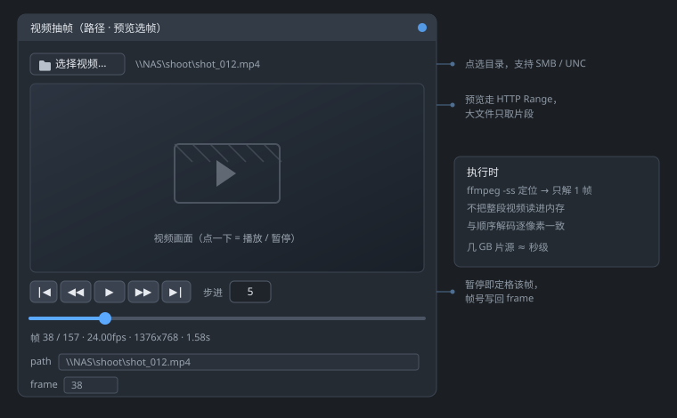

# ComfyUI-VideoFramePicker

**路径引用视频 → 节点内播放 / 拖帧选帧 → 执行时只解这一帧。**

一个 ComfyUI 视频抽帧节点，专治「视频在 NAS 上、不想为了一帧上传几个 GB」这件事。



> 节点名：`视频抽帧（路径·预览选帧）`　类名：`PathVideoFrame`　分类：`video`

## 为什么不用现成的

| 方案 | 预览里选帧 | 路径 / SMB 引用 | 大文件 |
|---|:--:|:--:|:--:|
| VHS `LoadVideo(Path)` | ✗ 只能填帧号盲猜 | ✓ | ✓ |
| VideoFrameMark | ✓ | ✗ 只认 `input` 目录 | ✗ 执行时全量解码 |
| Pixaroma `Load Video Frame` | ✓ | ✗ 只认 `input` 目录 | ✓ |
| **本节点** | ✓ 播放 / 拖帧 / 步进 | ✓ 本地路径 + UNC | ✓ 只解 1 帧 |

## 安装

```bash
cd ComfyUI/custom_nodes
git clone https://github.com/RBLiang1/ComfyUI-VideoFramePicker.git
```

重启 ComfyUI，在 `video` 分类下找到「视频抽帧（路径·预览选帧）」。

依赖（`requirements.txt`，ComfyUI 通常已自带）：

```
av              # 读视频头信息
imageio-ffmpeg  # 提供 ffmpeg 可执行文件
```

找不到 ffmpeg 时会回退到进程内 PyAV 逐帧解码（慢，但能出图）。

## 用法

### 输入 / 输出

| 输入 | 说明 |
|---|---|
| `path` | 视频路径。本地绝对路径 `D:\video\a.mp4`，或 SMB/UNC `\\NAS\share\a.mp4`，也支持映射盘 `Z:\a.mp4`。**不需要上传到 `input`**，不占本地空间。 |
| `frame` | 要抽的帧号，从 0 开始。节点内拖滑块、播放暂停、步进跳帧都会同步改这个值，也可以直接手填。 |

| 输出 | 说明 |
|---|---|
| `图像` IMAGE | 抽出的单帧 |
| `总帧数` INT / `fps` FLOAT / `宽` INT / `高` INT | 视频信息，顺手可喂给别的节点 |

### 节点上的操作

```
┌──────────────────────────────────────────────┐
│ [📁 选择视频…]  shot_012.mp4                  │ ← 点开目录浏览器挑片
│ ┌──────────────────────────────────────────┐ │
│ │         视频画面（点一下=播放/暂停）       │ │
│ └──────────────────────────────────────────┘ │
│ [|◀] [◀◀] [▶/‖] [▶▶] [▶|]   步进 [5]         │ ← 首帧/退N/播放暂停/进N/末帧
│ ●─────────────────────────────────────────── │ ← 帧滑块
│ 帧 38 / 157 · 24.00fps · 1376x768 · 1.58s    │
└──────────────────────────────────────────────┘
```

- **选择视频…** — 弹出目录浏览器，顶部可直接粘贴任意路径回车直达（`D:\video`、`\\NAS\share\素材`），
  下方列出子文件夹与视频文件（带大小，按修改时间倒序），点文件名即写入 `path` 并加载。
  底部有盘符条与「最近使用」，NAS 路径不用反复敲。
- **播放 / 暂停** — `▶` 开播，再点一次（或直接点画面）暂停。**暂停那一刻的画面就是参考帧**，
  帧号自动写回 `frame`；播放过程中不写 `frame`，避免把工作流刷成脏数据。
- **步进** — 先填 `步进`（1 / 5 / 12…），再点 `◀◀`、`▶▶` 就按这个数前后跳帧。
- **`|◀` / `▶|`** — 跳首帧 / 末帧。
- 拖滑块时若正在播放会先静默暂停，避免两套位置打架。

## 实现要点

- **预览**：节点里嵌 `<video>`，源是 `/pathvframe/stream`，支持 HTTP Range（206），
  浏览器自己按需取片段拖动，几 GB 的片源也不会被整段读进内存。
- **抽帧**：执行时用 `ffmpeg -ss <t> -i <path> -frames:v 1` 定位解码，子进程隔离，
  不会像进程内解码那样把 ComfyUI 卡死；实测与顺序解码的同一帧**逐像素一致**。
- **元数据**：`/pathvframe/meta` 用 PyAV 只读文件头，按 `路径 + mtime + size` 缓存，不反复打 NAS。
- **不阻塞**：所有文件系统调用都丢到线程池，列一个连不上的 NAS 目录也不会拖死 ComfyUI 主循环
  （实测：伪造不可达 UNC 卡 20s+ 时，`/system_stats` 仍 15ms 返回）。
- **不吃显存**：预览解码在浏览器侧（一般是核显），和 ComfyUI 的 CUDA 两条路。

## HTTP 路由

| 路由 | 说明 |
|---|---|
| `GET /pathvframe/meta?p=<路径>` | 元数据 `{ok, fps, frames, duration, width, height}`（`p` 需 URL 编码） |
| `GET /pathvframe/stream?p=<路径>` | 视频字节流，支持 `Range` / `HEAD`，206 分段 |
| `GET /pathvframe/browse?dir=<目录>&d=1` | 目录清单 `{ok, dir, parent, root, drives, dirs, files, n_dirs, n_files, selected}`；`dir` 传空 = 列盘符，传视频文件 = 打开所在目录并标出该文件 |

只接受「绝对路径或 UNC + 视频后缀」，目录浏览只返回文件夹名与视频文件名，不会变成任意文件读取接口。

## 已知限制

- **预览依赖浏览器原生解码**：mp4 / h264 / webm 稳。mkv、rmvb、avi 这类容器浏览器多半播不了，
  预览会黑屏 —— 但抽帧仍正常（ffmpeg 解码，不依赖浏览器），此时手填 `frame` 即可。
- **UNC 权限**：能访问的前提是运行 ComfyUI 的那个 Windows 账户本身有权限。若从未在该账户下
  建立过 SMB 会话，可能需要在资源管理器里先访问一次。
- 只做「读」，没有上传 / 转码 / 写回功能。

## 卸载

删掉本目录、重启 ComfyUI 即可，不会动任何用户数据。

## License

MIT
